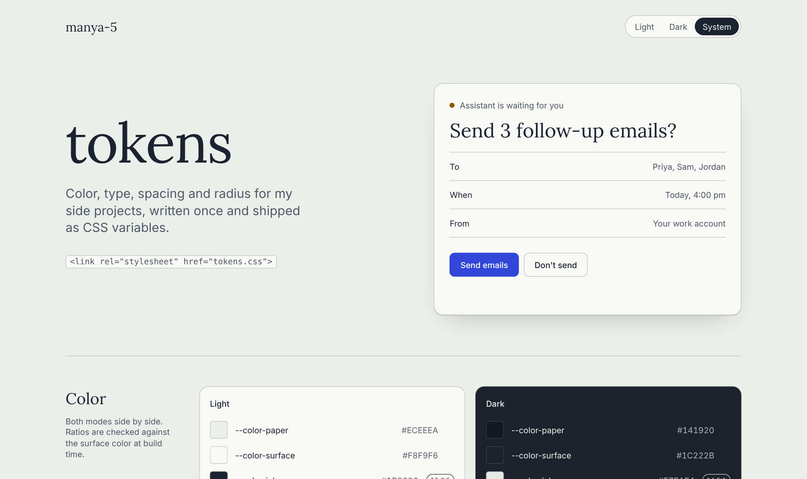

# tokens

A small design token set (color, type, spacing, radius) that builds into CSS variables.



**Live:** https://manya-5.github.io/tokens/

## Why I built this

I kept redefining the same colors and spacing in every side project. This puts them in one file I can link from anywhere. It also checks color contrast every time I change a value, so I don't have to remember to.

## How it works

- `src/tokens.json` is the only file you edit: two color modes, a type scale, a spacing scale and radii.
- `scripts/build.mjs` turns it into `dist/tokens.css` (CSS variables with light and dark modes) and `dist/tokens.json`.
- The build checks every text color against the backgrounds it sits on and fails if any pairing is below 4.5:1.
- The preview page in `docs/` reads the built files, so it always shows what you'd actually ship.

```html
<link rel="stylesheet" href="tokens.css">
<style>
  .card { background: var(--color-surface); padding: var(--space-5); border-radius: var(--radius-lg); }
</style>
```

Dark mode follows the system setting. Set `data-theme="light"` or `data-theme="dark"` on `<html>` to force one.

## Run it locally

Needs Node 18 or newer. No packages to install.

```bash
git clone https://github.com/manya-5/tokens.git
cd tokens
node scripts/build.mjs
python3 -m http.server 8000 --directory docs
```

Then open http://localhost:8000.
